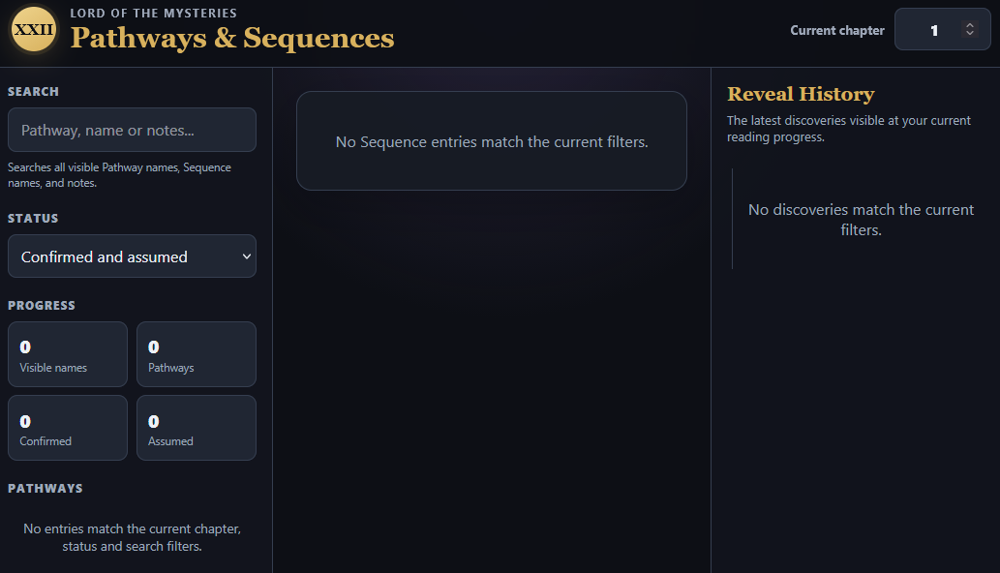
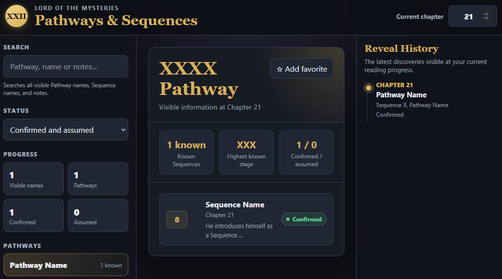

# Lord of the Mysteries – Pathways & Sequences Tracker

A spoiler-conscious interactive reference tool for readers of *Lord of the Mysteries*.

The goal of this little project is to make it easier to keep track of the different **Beyonder Pathways and Sequences** without accidentally revealing information from later chapters.

Instead of displaying all known information immediately, the tracker adapts its content to the reader's current chapter progress.

The tracker contains all revealed Pathway and Sequence names up to Chapter 1432 of *Lord of the Mysteries*.

It is **not** meant for *Circle of Inevitability*.

## 📖 How It Works

Enter the chapter you are currently reading in the top right corner.

The tracker uses that chapter number to determine which information should be visible.

For example, if a Sequence name has not yet been revealed at your current chapter, the tracker will not display it. As you progress through the novel, additional information gradually becomes available.

This makes the tracker particularly useful for **first-time readers** who want a reference for the increasingly complex Beyonder system without having to use wikis that may contain major spoilers.

## 📥 Download

**[Download the Pathways & Sequences Tracker](https://raw.githubusercontent.com/gabsllll/lotm-pathway-guide/refs/heads/main/Pathways%20and%20Sequences.html?download=1)**

After downloading, simply open the `.html` file in your browser. No installation is required.

## ✨ Features

- 📖 **Chapter-based spoiler filtering**
  - Enter your current chapter and only information available up to that point will be displayed.

- 🧭 **Pathway overview**
  - Keep track of the different Beyonder Pathways introduced throughout the story.

- 🔢 **Sequence tracking**
  - View the Sequence names that have been revealed by your current chapter.

- 🔒 **Progressive information reveal**
  - Pathway names, Sequence names and other information are revealed according to the reader's progress.

- ✅ **Confirmed and assumed information**
  - The tracker distinguishes between information that has been explicitly confirmed in the novel and information that is only implied or suspected at that point.

- 📝 **Chapter references and notes**
  - Entries can contain information about when and how a Pathway or Sequence became known.

- 🔎 **Search and filtering**
  - Quickly find Pathways and Sequences that have already been introduced.

- 🌙 **Dark interface**
  - Designed for comfortable use alongside long reading sessions.

- 💾 **Runs locally**
  - The tracker is contained in a standalone HTML file and can be opened directly in the web browser.

## 📷 Screenshots

### Overview

### Sequence Details

## ⚠️ Spoiler Notice

This project is designed to **minimize spoilers**, but it cannot guarantee a completely spoiler-free experience.

Information is manually assigned to the chapter at which it is revealed, mentioned, confirmed, or reasonably implied in the novel.

## 🤝 Contributing

Corrections and improvements are welcome.

If you find:

- an incorrect chapter reference,
- information revealed too early,
- an incorrect confirmation status,
- or another spoiler-related issue,

feel free to contact me.

## Disclaimer

This is an unofficial fan-made project.

This project is intended as a reference tool for readers and is not affiliated with or endorsed by the author, publisher, or official rights holders.
